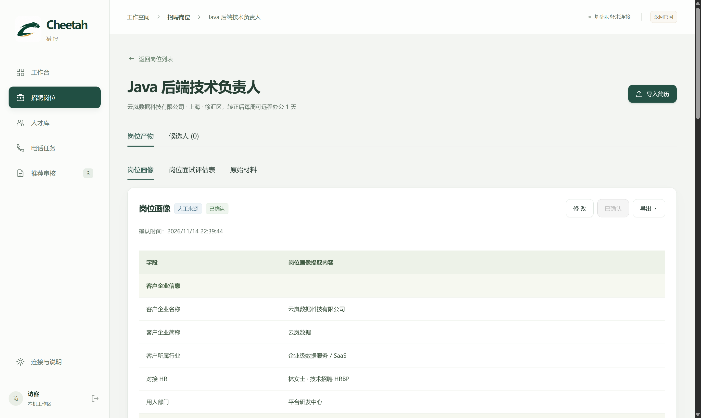
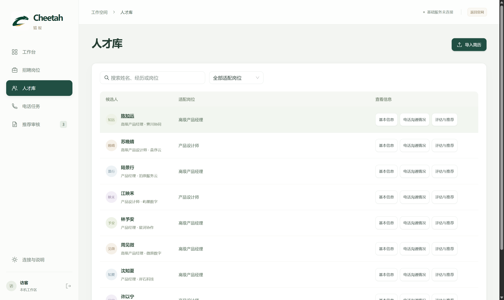
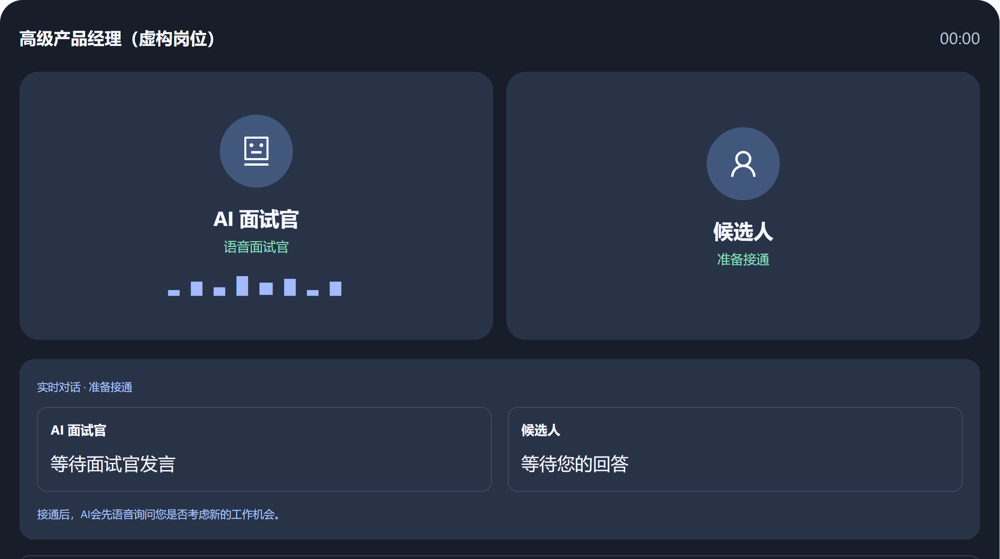
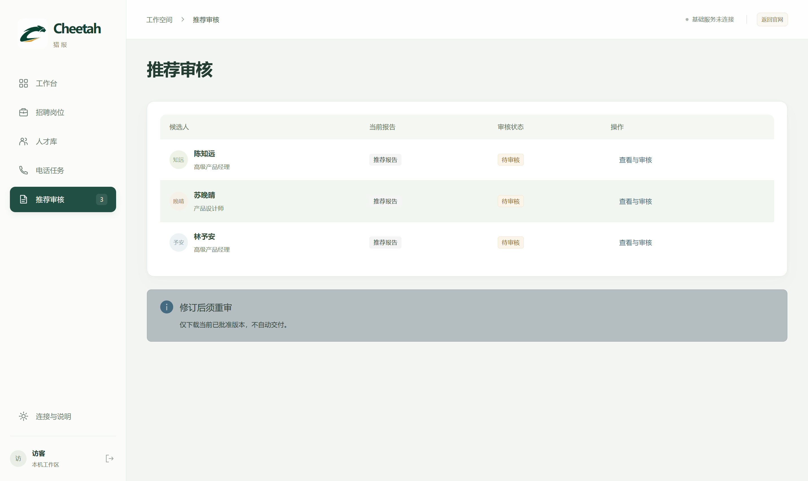

# Cheetah 猎报

**找对人，快人一步。**

面向猎头顾问与猎头公司的 AI 招聘工作台，围绕需求梳理、人才入库、简历初筛、AI 沟通与推荐审核，减少重复整理，让顾问把时间留给关键沟通与专业判断。

[在线体验](https://cheetah.asia/) · [图文使用指南](https://nankai.feishu.cn/wiki/K2VGweSJjiHgcNkWnf6cEqEsnff) · [功能与用法](#功能与用法) · [本地运行](#本地运行与开发)


## 为什么选择猎报

| 猎头痛点 | 猎报提供的帮助 | 公司价值 |
| --- | --- | --- |
| 需求沟通后反复整理 | 将沟通文字整理为岗位画像、JD 与面试评估表 | 减少会后整理与需求对齐成本 |
| 简历多，分拣匹配耗时 | 统一入库，按职能方向关联相关岗位 | 减少人工分拣与重复录入 |
| 经历包装，个人贡献难核实 | 梳理经历，结合公开研究线索列出核实问题 | 让筛选与推荐更有依据 |
| 逐人准备与沟通占用时间 | 准备个性化提纲，提供 AI 会议沟通入口 | 把顾问时间留给关键沟通 |
| 暂不匹配，资料容易沉没 | 留存人才档案，供新岗位再次关联 | 将候选人积累为长期人才资产 |

## 功能与用法

**明确需求 → 积累人才 → 深度初筛 → 沟通核实 → 审核推荐**

| 功能 | 怎么使用 | 可以查看或获得什么 |
| --- | --- | --- |
| **岗位需求梳理** | 在「招聘岗位」创建岗位，粘贴或导入沟通文字，复核生成内容 | 岗位画像、招聘 JD、面试评估表；支持修改及分别导出 Word / PDF |
| **人才库与岗位关联** | 在「人才库」导入简历，查看档案与适配岗位 | 结构化经历、职能分类及相关岗位；暂无适配岗位的人才仍保留 |
| **简历深度初筛** | 进入岗位候选人详情，在岗位筛选标准正式发布后启动初筛 | 岗位相关研究、评估依据与待核实项；信息不足保留未知 |
| **AI 沟通** | 在沟通详情查看提纲和邀请；候选人通过邀请进入独立面试页 | 面试准备、会议界面、沟通记录与后续评估 |
| **评估与推荐** | 在「评估与推荐」查看报告，在「推荐审核」复核具体版本 | 内部评估与对外推荐分开呈现；当前有效且已批准的推荐报告可导出 |

## 界面预览

岗位、人才库、AI 会议与推荐审核的演示界面。

<details open>
<summary>岗位画像：把沟通材料变成可复核的招聘要求</summary>

进入岗位后，在「岗位产物」查看画像与面试评估表，修改后重新确认，也可分别导出。



</details>

<details>
<summary>人才库：一次入库，查看多个岗位机会</summary>

通过搜索与岗位筛选定位人才，分别查看基本信息、电话沟通情况及评估与推荐；同一人才的不同岗位记录分别查看。



</details>

<details>
<summary>AI 会议：围绕岗位与个人经历开展初步沟通</summary>

候选人通过面试邀请进入会议，参与者状态与对话字幕集中呈现。



</details>

<details>
<summary>推荐审核：交付前，由顾问把关</summary>

进入「查看与审核」复核匹配理由、依据和待核实事项，审核通过后导出当前版本报告；修订后重新审核。



</details>

## 每一步有据，每一荐有因

缺失信息保留未知，团队成果与个人贡献分别判断；内部评估和对外推荐分开，具体推荐版本经过人工审核。AI 辅助整理与分析，顾问负责专业判断与关系建立。

**Cheetah，意为猎豹。**「猎」来自猎头识人的专业，「报」承载有据可循的报告，也寄托报来好消息的期待。

## 本地运行与开发

只看官网和交互演示，需要 **Node.js 24 与 npm**：

```powershell
cd frontend
npm ci
npm run dev
```

打开 [http://127.0.0.1:5173](http://127.0.0.1:5173)，从官网进入演示工作台。注册、账号数据和模型任务需要启动后端。

完整环境准备、启动与检查命令见[开发与本地运行](docs/development-guide.md)。产品定义见[产品需求文档](docs/Cheetah_产品需求文档_V0.5.md)。

功能接入记录见[前端交付说明](docs/frontend-delivery.md)、[人才入库与职能分流](docs/talent-routing.md)及[整合说明](docs/branch-integration.md)。

欢迎通过 [Issues](https://github.com/Jankin-Chen123/Cheetah/issues) 分享招聘场景与体验反馈。
