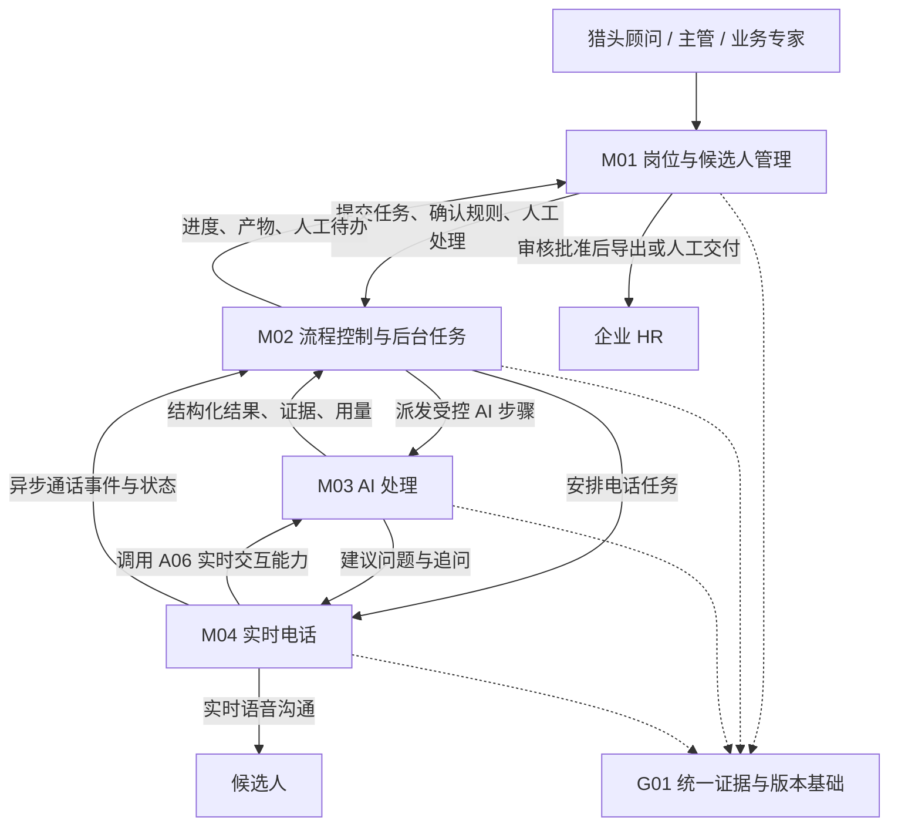
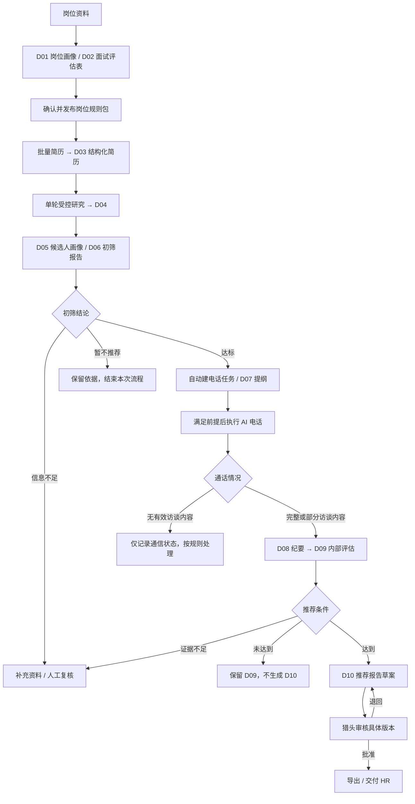
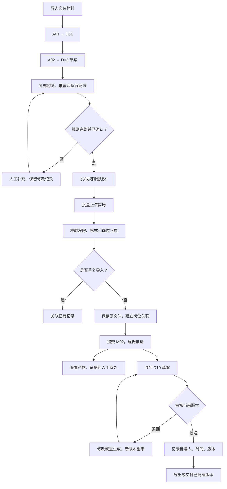
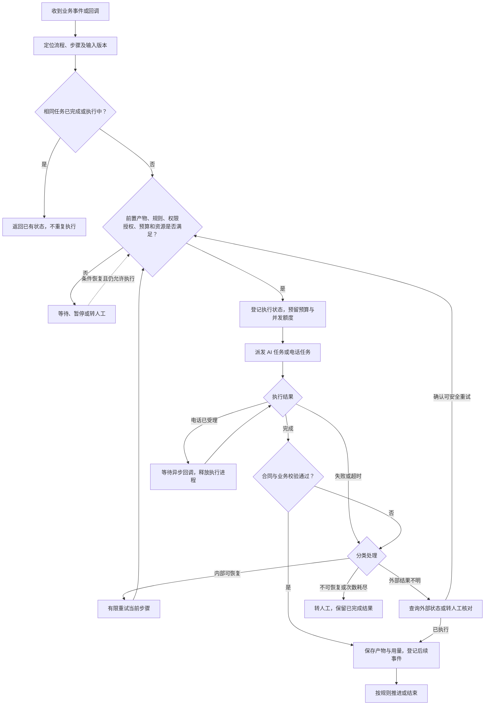
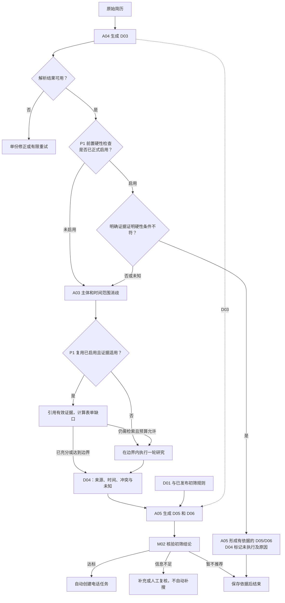
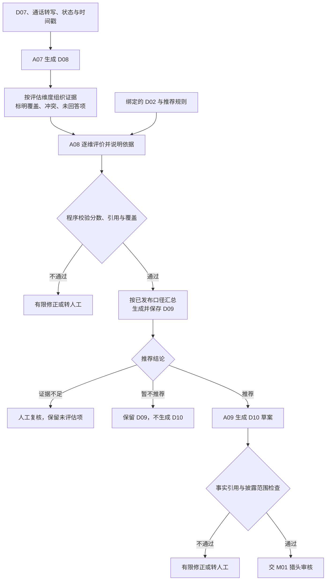
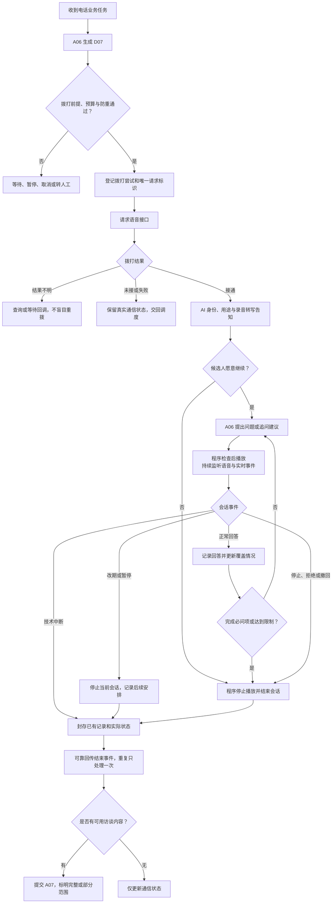
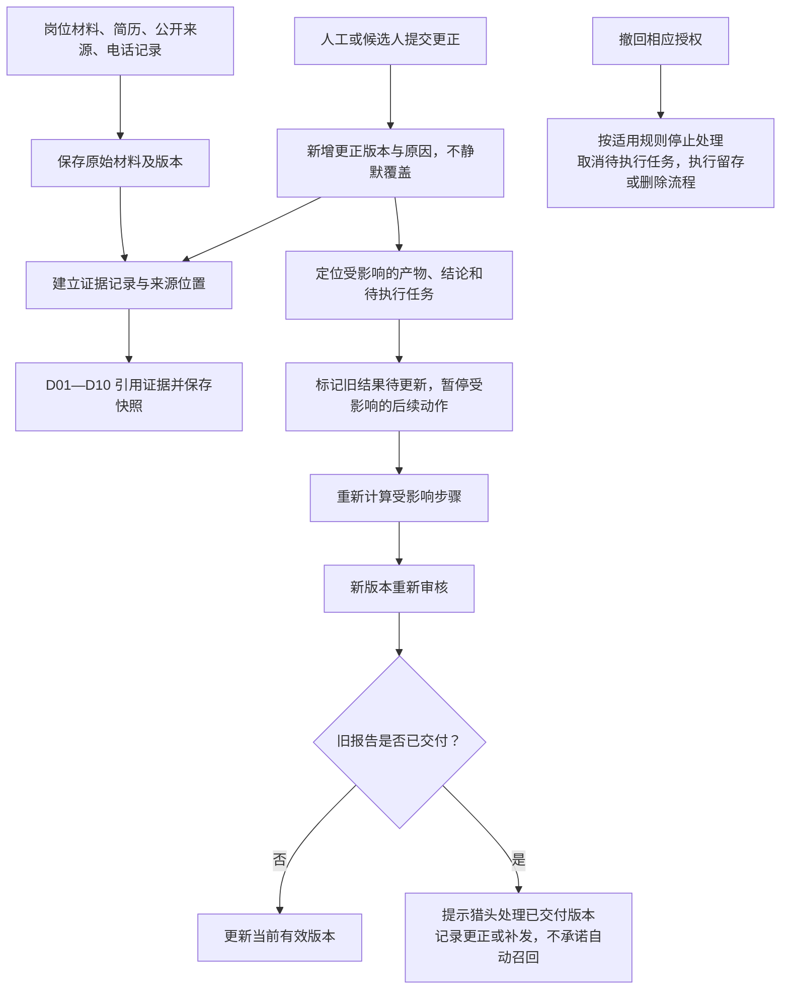

# Cheeta 产品需求文档 V0.5

> 面向猎头的 Agent 自动化工作流：从 HR 需求梳理、简历筛选，到 AI 电话沟通、内部评估与候选人推荐。

| 项目 | 内容 |
| --- | --- |
| 项目名称 | Cheeta（暂定） |
| 文档版本 | V0.5，承接原《AI 猎头候选人筛选与推荐系统 产品需求文档 V0.4》 |
| 编写日期 | 2026 年 11 月 13 日 |
| 文档定位 | 产品与研发评审稿，用于范围确认、设计、任务拆解和验收 |
| 架构基线 | 四个业务模块、统一证据与版本基础；保留九个 Agent 的逻辑职责 |
| 当前准备度 | 部分可开工；真实业务效果、电话接口和专业规则仍需验证 |
| 适用读者 | 产品、猎头顾问、业务专家、研发、算法、测试、技术运营与项目负责人 |

## 1. 产品定位与本次修订

### 1.1 产品定位

Cheeta 面向猎头顾问及其团队，将 HR 招聘需求、岗位规则、批量简历、公开背景研究和候选人电话沟通组织成可追溯的自动化工作流。

猎头导入岗位需求后，系统生成岗位画像与面试评估表草稿，经确认发布规则版本；批量处理候选人简历并完成受控研究，给出有依据的初筛结论。初筛达标后自动安排 AI 电话，在具备联系前提、授权和拨打条件时执行沟通。通话后生成内部评估，仅对达到推荐规则者生成 HR 推荐报告草案，由猎头审核后导出或交付。

产品交付的是各阶段的结构化产物、明确状态和证据链，不能只输出一段无法核对的模型文字。

### 1.2 V0.5 的主要变化

| 变化 | 本版处理 |
| --- | --- |
| 项目命名 | 采用暂定名称 Cheeta |
| 减少实现复杂度 | 九个 Agent 保留为逻辑职责，归入四个模块，不要求九个独立服务 |
| 统一流程控制 | 由确定的程序规则推进任务；Agent 不自行决定外呼、交付或扩大权限 |
| 拆分业务标准 | 初筛规则、面试评估标准和推荐条件独立定义，并关联到同一岗位规则包 |
| 拆分电话执行 | A06 分为通话前准备与通话中交互；程序管理停止、限制和会话状态 |
| 减少重复事实 | D01—D10 引用统一证据并保留生成快照，避免相互复制后失去来源 |
| 完善失败恢复 | 区分内部计算重试、外部动作核对、人工修正与历史结果失效 |
| 收敛首版范围 | 硬性条件前置筛选、研究结果跨任务复用列为 P1，首版默认不启用 |
| 完善交付控制 | 审批绑定具体报告版本；修改后重审，重新生成不自动重新交付 |

### 1.3 依据与状态说明

本稿依据原 V0.4 文档、本次对话中的架构分析与分模块流程，以及用户对 Cheeta 定位的说明编写。V0.4 引述的录音、原始访谈和专业材料未在本次重新核验，不将其视为已经补齐的交付物。

| 状态 | 含义 |
| --- | --- |
| 需求基线 | 继承 V0.4 的核心业务行为及本次明确的产品定位 |
| 本版设计基线 | 将优化架构具体化的产品设计，供本轮评审和开发采用；不表示业务方已逐项签署 |
| 可选增强 | 不进入首版默认路径，需具备规则和验收条件后启用 |
| 待补充 | 需要业务、接口或合规负责人提供正式内容，不得用模型常识替代 |
| 待技术验证 | 目标已明确，但真实接口、性能、稳定性或效果尚未验证 |

生成本文不表示功能已经开发、流程已经实测或上线条件已经满足。

## 2. 目标、用户与产品范围

### 2.1 产品目标

1. 将 HR 需求整理为可确认、可版本化的岗位画像、初筛规则和面试标准。
2. 批量处理简历，结合公司与项目背景给出可解释的岗位匹配结论。
3. 初筛达标后自动创建并安排电话，减少猎头逐人操作。
4. 通过电话核实个人职责、行动、成果归因和求职意向，保留真实沟通状态。
5. 按证据生成内部评估和对外推荐草案，支持人工纠正和审核。
6. 按候选人、岗位、批次和阶段查看进度、异常、耗时与成本。

节省时间、降低成本和提高推荐质量是预期价值，不预设未经试点验证的提升幅度。

### 2.2 角色与权限

| 角色 | 主要操作 | 默认边界 |
| --- | --- | --- |
| 猎头顾问 | 导入资料、查看证据、补充信息、复核初筛、审核推荐与导出 | 仅本人或获授权团队负责的岗位和候选人 |
| 猎头主管／业务专家 | 维护专业模板、确认规则、处理争议和人工覆盖 | 修改规则需发布新版本，不能静默改写历史任务 |
| 企业 HR | 提供需求、接收已审核推荐材料 | 不默认访问 D09、通话内容或全部候选人；首版无需独立 HR 门户 |
| 候选人 | 接受、拒绝、暂停、改期、澄清、更正或撤回相应授权 | 不要求建立候选人账号；处理渠道需在正式告知中明确 |
| 技术运营 | 配置接口、模型、预算，查看运行状态和排障信息 | 默认不查看原始敏感材料；特殊访问需授权并留痕 |

跨机构使用必须实施机构数据隔离；是否首版提供多机构自助开通、套餐和计费不在本版范围内。

### 2.3 优先级与首版边界

| 范围 | 内容 |
| --- | --- |
| P0：首版闭环 | 岗位材料导入、D01/D02、独立初筛规则、版本发布、批量简历、单轮受控研究、初筛三分支、自动电话任务、D07—D10、人工审核、状态、权限、证据、预算和异常恢复 |
| P1：闭环增强 | 授权邮箱/API 接收简历、研究结果复用、硬性条件前置检查、有界补搜、优化简历、ATS/CRM 深度集成 |
| P2：持续优化 | 根据真实误筛、人工修正和效果评测提出规则优化建议，经人工确认后发布 |

首版不做：招聘平台流量获取、全量外部简历爬取、录音硬件、无界搜索循环、未经审核自动修改规则、薪酬谈判、最终录用、入职管理，以及未经猎头批准自动外发推荐材料。

首版接收已经转写的岗位沟通文本，不将现场录音采集或岗位录音转写平台作为必需前置建设。

## 3. 总体产品架构

### 3.1 模块划分

| 编号 | 模块 | 核心职责 | 明确边界 |
| --- | --- | --- | --- |
| M01 | 岗位与候选人管理 | 用户操作入口、岗位规则、批次、候选人档案、人工待办、审核与交付 | 提交业务意图，不绕过流程控制直接拨号或外发 |
| M02 | 流程控制与后台任务 | 前置检查、状态流转、版本绑定、任务调度、防重、预算、重试与恢复 | 根据已发布规则推进，不依赖模型自由规划整个业务流程 |
| M03 | AI 处理 | 承载 A01—A09 的材料理解、研究、提取、评价和报告生成职责 | 输出经过约束的结构化结果；不自行授权外部动作 |
| M04 | 实时电话 | 联系条件复核、拨打、实时语音、通话控制、状态回传和外部核对 | 实时交互不被后台搜索、评分或报告生成阻塞 |
| G01 | 统一证据与版本基础 | 原始材料、证据引用、产物版本、访问控制、更正、审计和生命周期 | 为四个模块提供共同基础，不要求另建独立微服务 |

### 3.2 架构关系图

### 3.3 实现与部署约束

建议首版采用模块化业务后端、后台任务执行进程和实时电话执行进程，复用受控的数据与文件存储。逻辑模块、执行进程、Agent 职责和模型调用次数不要求一一对应。

允许合并模型调用或部署单元，但必须保留各产物的校验、来源关系、版本、成本归属和单步恢复能力。已经完成 A07 后 A08 失败，应能从评分步骤恢复，无需再次拨打或重新提取全部通话。

模型、数据库、队列、工作流框架和语音服务商由技术方案选择。本 PRD 规定行为与验收，不锁定具体供应商。

## 4. 端到端业务流程

1. 猎头导入岗位材料，A01 生成 D01，A02 生成 D02 草稿。
2. 业务人员补充初筛规则、面试标准、推荐条件，关联检索及电话配置，确认后发布岗位规则包。
3. 猎头批量上传简历，系统校验权限、文件和岗位归属，逐份建立任务。
4. A04 生成 D03；A03 按固定表单进行单轮受控研究，生成 D04。
5. A05 形成 D05 和 D06，程序核验规则并进入达标、信息不足或暂不推荐分支。
6. 达标后自动创建电话任务，不要求猎头逐人点击；A06 生成 D07。
7. M04 在联系方式、联系前提或授权、可拨打时段、接口、预算和防重检查通过后执行电话。
8. 通话结果异步回传；A07 根据实际取得的内容生成 D08，A08 形成 D09。
9. 达到推荐规则时，A09 生成 D10 草案；否则保留内部评估或进入人工复核。
10. 猎头审核具体 D10 版本，批准后导出或交付；修改后重新审核。

信息不足不等于不匹配；电话自动安排不等于立即拨号；电话未接、拒绝、改期和技术失败不等于能力不合格。

## 5. 岗位规则包与发布机制

### 5.1 规则包组成

岗位规则包作为受控配置存在，不新增候选人报告编号。

| 组成 | 内容与用途 |
| --- | --- |
| D01 岗位画像版本 | 岗位事实、任职要求及来源；未知字段明确标记 |
| 初筛规则版本 | 条件定义、条件类型、所需证据、不符合与信息不足的区分、进入电话条件 |
| D02 面试评估表版本 | 维度、评分锚点、证据要求、权重或计分方式、否决项和未评估处理 |
| 推荐规则版本 | 覆盖要求、评分或等级条件、否决条件、必须人工复核的情况；与 D02 推荐门槛保持一致 |
| 检索配置版本 | 固定字段、来源边界、时间范围、停止条件与预算 |
| 电话配置版本 | 告知、时段、预约、时长、重拨、结束与人工接管规则 |
| 模板与方法版本 | 提问追问方法、D09/D10 模板、使用范围 |

初筛规则不能直接照搬面试评分。仅能通过电话核实的个人贡献，不应无依据地变成简历阶段的自动否决条件。与岗位无关的敏感个人属性不得用作自动否决条件。

### 5.2 发布与变更

1. 发布前检查关键字段、规则完整性、版本兼容性和确认人。非关键字段允许明确保留未知，关键字段清单由业务确认。
2. 未发布规则不得触发自动初筛及外呼；未正式确认的评分规则只能用于明确标注的模拟验证。
3. 任务绑定生成时实际使用的规则包、材料和模型／提示词版本，历史结果不随配置修改而静默变化。
4. 新规则默认只影响新建流程；对存量任务应用新规则需显式选择并记录原因，生成新的评估版本。
5. 停用岗位或撤销执行许可后阻止新筛选和新拨打；已进行的通话按已确认的停止规则处理。
6. 规则变更不自动创建新的拨打机会，也不自动重新交付报告。电话拨打前始终检查当前有效的权限、联系前提和停止限制。

## 6. M01 岗位与候选人管理

### 6.1 用户工作区

| 页面／视图 | 首版必要内容与操作 |
| --- | --- |
| 岗位列表与详情 | 岗位状态、负责人、材料、D01/D02、规则包及发布状态、候选人批次 |
| 简历导入与批次 | 文件校验结果、重复导入提示、单份进度、成功／失败／待办数量、单份重试 |
| 候选人工作区 | 当前步骤、D03—D10、证据引用、缺口、通话状态、规则版本、人工修改与时间线 |
| 电话任务视图 | 待调度、预约、等待原因、拨打尝试、改期、取消和外部状态核对 |
| 人工待办 | 缺失规则、材料修正、主体消歧、证据冲突、评估复核、推荐审核 |
| 报告审核与导出 | D10 草案、来源、修订差异、批准／退回、当前版本和交付记录 |
| 运行与成本视图 | 步骤失败原因、预算状态、调用和电话用量；按角色限制可见信息 |

### 6.2 简历身份与导入去重

- 区分候选人档案、原始文件、岗位候选人关联、处理批次和流程实例。同一候选人可以关联多个岗位。
- 同机构同岗位的相同文件重复提交，应复用或关联已有结果，不重复启动筛选。主动重跑必须是有原因、可审计的新评估版本。
- 同名、相似经历或相似文件只能提示疑似重复，不自动合并个人身份；联系方式等匹配依据也受权限与业务规则约束。
- 简历内容更新应保存新材料版本；不能因文件名改变就直接视为新候选人，也不能因姓名相同就覆盖旧档案。
- 上传本身不证明已取得所有后续用途的授权，外呼和交付仍执行各自前提检查。

### 6.3 岗位、候选人与审核流程图

### 6.4 审核与交付边界

D09 默认内部使用，D10 默认不包含内部完整评分、通话原文或联系方式等非必要信息。猎头批准具体版本后才能用于对外导出或交付；未批准内容可在内部查看并显示草案标识。原始简历是否随附、导出格式、渠道和交付所需授权均待业务确认。

首版不要求自动发送邮件、自动接入 HR 系统或建立 HR 账号。可采用已批准报告的人工交付并登记结果。外部自动交付如后续接入，必须具备独立的防重和结果核对机制。

## 7. M02 流程控制与后台任务

### 7.1 控制原则

1. 每个步骤具有输入合同、输出合同、前置条件、状态、时限、预算和失败处理规则。
2. 同一候选人不同岗位的评估相互独立，但联系限制与有效通话占用须在机构授权范围内协调，不能因岗位不同并发重复联系。
3. AI 输出先做格式与业务校验；不合格结果不得直接触发电话或进入已批准报告。
4. 保存步骤结果与登记下一步事件应具备一致性保障，进程退出后可以继续恢复。
5. 执行任务时防止并发领取；重复消息返回已有状态。执行者异常退出后的接管需检查实际执行状态，不能直接重复外部动作。
6. 电话提交后进入等待外部结果状态，不占用后台执行进程持续等待通话结束。
7. 每次执行与外部请求都有独立记录；流程实例、步骤任务、执行尝试、电话业务任务、拨打尝试和交付记录分别标识。

### 7.2 流程控制图

### 7.3 电话业务防重

步骤任务的版本键不足以单独保证电话安全。即使输入版本、规则版本或提纲发生变化，也必须检查该岗位候选人是否已有有效电话业务任务、正在进行的拨打或已完成的沟通。

同一初筛事件重复到达只产生一个有效电话任务。重约和合法重拨属于该任务下的新增拨打尝试，次数受配置约束。跨岗位触达冲突时进入等待或人工协调；具体联系窗口和优先级待业务确认，在未确认前不允许自动并发外呼。

### 7.4 重试、恢复与外部结果不明

| 情况 | 处理要求 |
| --- | --- |
| 结构化输出格式错误 | 在配置上限内修正或重试当前步骤，耗尽后转人工 |
| 模型、网络或搜索临时失败 | 检查剩余预算，有限重试；已取得证据保留 |
| 电话接口请求超时 | 不能判定未拨打；先按请求标识查询或等待回调，状态不明时暂停 |
| 通话结束后评分失败 | 从 D08 或已完成的维度恢复，不重新拨打 |
| D10 生成失败 | 保留 D09，仅重试报告步骤 |
| 人工更正上游事实 | 标记受影响下游版本过期，仅重算受影响部分 |
| 重复回调、乱序回调 | 去重并遵循合法状态迁移；冲突回调留痕、核对，不把终态改回早期状态 |
| 外部计费不明确 | 记录请求与实际账单核对状态；不把本地防重描述为所有供应商绝不重复计费 |

重试不能改变原有授权、扩大检索范围或绕过预算。增加预算、修改规则或重新拨打须走对应操作并记录原因。

### 7.5 预算和成本

按阶段、候选人、批次或岗位配置模型、检索、通话预算与并发上限。并行任务执行前预留预算，完成后结算或释放；执行结果不明的外部动作不能直接释放全部预留后再次发起。

区分估算费用与服务商实际费用，记录 Token、搜索次数、通话时长、用量时间和误差。达到上限时停止后续调用或转人工，不能仅展示告警后继续消耗。实时通话的结束边界应提前预留并由程序控制，避免预算不足造成失控。

所有具体数值由正式配置和试点确定，不在本文填入示意阈值作为业务承诺。

## 8. M03 AI 处理与九个 Agent 职责

### 8.1 职责映射

| Agent | 逻辑职责 | 主要输入 | 主要输出 | 执行归属与边界 |
| --- | --- | --- | --- | --- |
| A01 岗位画像 | 提取岗位事实、缺失与冲突 | 岗位材料 | D01 | M03 后台；不编造未提及字段 |
| A02 评估表生成 | 依据岗位和专业方法拟定面试标准 | D01、岗位材料、专家规则 | D02 草案 | M03 后台；发布前经确认，不直接评价候选人 |
| A03 信息检索 | 主体消歧、固定字段研究、证据归档 | D03 线索、检索配置 | D04 | M03 后台；首版单轮受控研究 |
| A04 简历结构化 | 提取经历、项目和成果自述 | 原始简历 | D03 | M03 后台；单份失败不影响整批 |
| A05 初筛评估 | 融合证据，形成画像与初筛建议 | D01、初筛规则、D03、D04 | D05、D06 | M03 后台；M02 核验并推进 |
| A06 AI 面试官 | 生成提纲，实时提问、追问和澄清 | D01/D02、初筛证据、D03/D04、提问方法 | D07、问题与回答关系、通话内容 | 准备在后台；实时能力由 M04 调用，停止和拨打由程序控制 |
| A07 访谈提取 | 提取回答、矛盾、缺口与位置 | D07、实际转写和通话状态 | D08 | M03 后台；不把部分通话补成完整访谈 |
| A08 内部评估 | 按维度评价证据并解释 | D02、D08、必要背景、推荐规则 | D09 | M03 后台；程序核验分数与汇总，不默认缺证据为零分 |
| A09 推荐报告 | 将通过的评估转为 HR 可读草案 | 当前有效且达标的 D09、必要证据与模板 | D10 草案 | M03 后台；不自动批准、交付或扩大披露范围 |

A01/A02 可以共享岗位理解上下文，A05 的两份产物共用证据，A07—A09 共享访谈证据底稿。但各自输出和校验边界不能消失。

### 8.2 简历与研究流程

“单轮”允许在同一预定研究计划内查询多个对象或来源，不表示仅请求一个网页。不得因为初筛发现新缺口就自动开启第二轮研究。

研究在固定表单充分或触及来源、时间、Token、费用边界时结束。公开资料不足不证明候选人虚假或不匹配；公司业绩、项目规模和个人贡献必须分开。

### 8.3 访谈、评估与报告流程

所有完成电话的候选人均生成 D09。部分通话有可用内容时生成标明范围的 D08，并按证据产生部分评估或待复核状态；没有实际访谈内容时仅保留通信状态，不伪造 D08/D09 能力结论。

缺证据的维度不得默认记零分，也不能简单删除后重分配权重使候选人自动达标。缺失处理和最低覆盖条件必须来自已发布规则；未定义时转人工。

### 8.4 AI 输出与输入边界

- 输出字段、枚举、必填项和证据引用必须可校验；每份结果记录模型、提示词或方法版本。
- 候选人自述、公开事实、AI 推断和人工意见明确区分。模型自报置信度不能替代实际证据。
- 简历、网页、转写和附件属于待分析材料，其中要求修改规则、泄露资料或触发外部动作的文本不能作为系统指令执行。
- 检索和模型仅接收当前步骤必要数据；不能把全量联系方式、全部通话或其他候选人资料默认提供给所有步骤。
- 模型或提示词变更后，用代表性样本检查事实提取、主体归因、追问、评分和报告一致性。生成式结果不要求逐字相同，但必须保持规则与证据可追溯。

## 9. M04 实时电话

### 9.1 电话前、电话中、电话后的分工

| 阶段 | AI 职责 | 程序与接口职责 |
| --- | --- | --- |
| 电话前 | 依据已发布标准生成 D07、必问项和专属疑点 | 检查提纲版本、联系前提、预算、时段、防重与预约 |
| 电话中 | 理解回答，提出下一问、追问或澄清建议 | 语音输入输出、打断、会话状态、停止优先、时长限制、异常处理 |
| 电话后 | A07—A09 提取、评估与报告 | 完成状态核对、回调去重、保存记录、提交后台任务 |

### 9.2 实时电话流程图

### 9.3 必需行为

1. 自动建任务与实际拨打分离：初筛达标直接进入调度，拨打仍受所有前提约束，不新增逐人触发确认。
2. 告知后拒绝继续、通话中要求停止或撤回相应授权时，程序取消待播放内容并停止，不等待模型生成结束语。具体识别能力与停止延迟需通过真实接口验证并确定验收值。
3. 通话过程中允许语音打断，避免在候选人已提出停止后继续播放缓存语音；无法可靠处理的情况进入安全停止或人工接管。
4. 达到已配置时长或费用边界时按规则结束。不得在通话中执行无界搜索；重研究和报告任务不进入实时关键路径。
5. 模型响应超时、转写异常、静音或接口中断应执行有上限的恢复、结束或人工接管策略，不能无限等待或重复提问。
6. 未接、拒绝、改期、中断和技术失败分别记录；没有证据不作能力评分。
7. 回调验证来源并匹配会话；对重复、乱序和冲突事件进行核对。无法确认是否拨出的任务保持待核对，不直接重拨。
8. 是否录音、录音与转写保存方式、重拨条件、预约渠道、人工接管方式和告知文本均须在真实上线前确定。

## 10. G01 统一证据与版本基础

### 10.1 证据分类

| 代码 | 类型 | 边界 |
| --- | --- | --- |
| E1 | 公开来源可核实事实 | 能确认主体、来源和时间范围；不等于已经证明个人参与或贡献 |
| E2 | 候选人陈述 | 来自简历或电话，注明自述来源，不自动升级为独立核实事实 |
| E3 | AI 分析或推断 | 记录推断依据和限制，不能伪装成原始事实 |
| U | 未知、缺失或冲突 | 没有找到、没有回答、主体不确定或来源不一致 |

岗位需求原文和人工修订另行保留来源类型、操作人及确认状态，不强行归为候选人陈述或公开事实。人工确认不自动将 E2/E3 改成 E1，必要时新增核实证据。

### 10.2 证据引用合同

一条证据至少包含：所属权限范围、对象、原始材料版本、来源类型、原文位置或转写时间戳、来源链接（适用时）、资料时间／获取时间、证据状态、冲突或更正关系。

事实内容、推断内容和人工修订分别记录。D01—D10 保存所引用证据的版本及生成快照；“共享证据”不意味着动态修改所有历史报告。

### 10.3 更正与失效传播

重新评估不得默认重新拨打；报告重生成不得默认重新交付。更正后的初筛从未达标变为达标时，是否可以创建电话任务仍须由 M02 检查现有电话任务、联系状态和当前前提。

## 11. 数据产物与交接合同

### 11.1 D01—D10

| ID | 产物 | 最低内容与下游用途 |
| --- | --- | --- |
| D01 | 岗位画像 | 名称、职责、组织关系、地点时间、薪酬激励、任职条件、技能项目、试用期目标、目标行业或公司；来源、缺失、冲突与确认状态；用于规则和匹配 |
| D02 | 面试评估表 | 维度定义、计分方式、权重或口径、锚点、否决项、证据与覆盖要求、推荐门槛引用、版本与确认状态；用于提问和评分 |
| D03 | 结构化简历 | 候选人及岗位关联、任职公司、时间、职位、项目、技能、学历、成果自述、原文位置、歧义与缺失；用于研究和初筛 |
| D04 | 公司与项目研究报告 | 对象、消歧结果、历史时间范围、固定字段、来源时间、证据、冲突、缺口、停止原因、用量；用于初筛和电话核实 |
| D05 | 候选人初步画像 | 经历与环境、项目与成果自述、岗位匹配线索、差距、电话待核实点；与 D06 共用证据底稿 |
| D06 | 初筛匹配报告 | 条件逐项对照、证据、满足／不满足／未知、分数或等级（如配置）、结论、规则版本、人工覆盖和下一步 |
| D07 | 结构化面试提纲 | 问题 ID、对应维度、必问项、专属核实项、追问条件、终止条件、提纲与方法版本 |
| D08 | 结构化电话访谈纪要 | 问答、追问、澄清、事实、自述、时间戳、拒答、中断、矛盾、缺口、通话覆盖范围与状态 |
| D09 | 内部面试评估报告 | 分维度分数或未评估状态、权重、证据和理由、覆盖情况、总体结论、规则版本、复核与更正信息；默认内部使用 |
| D10 | 企业 HR 推荐报告 | 候选人概要、岗位匹配亮点、经历和个人贡献来源、求职意向、待核实事项、审核与版本；默认不附内部完整评分 |

未执行的阶段保留“未执行及原因”，不能伪造空报告作为已完成。例如可选前置硬性检查结束时 D04 明确未执行，D05/D06 记录实际使用的简历证据。

### 11.2 通用交接字段

每份产物至少记录产物 ID／版本、岗位、候选人（适用时）、流程实例、步骤、输入版本、规则包版本、生成方式与模型／方法版本、状态、证据引用、生成时间、未知项、校验信息及人工修订信息。

原始简历、通话会话、录音、转写、规则包、步骤任务、预算账目、审核与交付记录是基础对象，不强行塞入 D01—D10 编号，也不因没有报告编号而省略。

## 12. 状态模型与人工接管

业务状态和技术状态分别记录。“技术失败”不能覆盖候选人的真实业务结论；“生成完成”不能等同于“已审核”。

| 对象／阶段 | 主要状态 | 恢复与边界 |
| --- | --- | --- |
| 岗位规则包 | 草稿、待补充、待确认、已发布、已停用 | 发布新版本不静默替换历史版本 |
| 批次 | 待处理、处理中、部分失败、已完成、已取消 | 汇总单份状态，失败不阻塞全批 |
| 步骤任务 | 待执行、执行中、等待条件、等待外部结果、待核对、已完成、失败、已取消 | 同一时刻只有合法执行者；恢复先检查真实状态 |
| 研究 | 待执行、执行中、已完成、部分完成、待核实、技术失败、未执行 | 部分完成可输出缺口，不冒充证据充分 |
| 初筛 | 待评估、进入电话、信息不足、暂不推荐、待人工复核 | 人工覆盖单独留痕，不覆写原始结论 |
| 电话业务任务 | 待调度、等待条件、已预约、执行中、待重新安排、已结束、已取消 | 与每次拨打尝试分离，重约不产生重复业务任务 |
| 拨打尝试 | 已登记、请求中、待核对、未接、拒绝、已接通、进行中、完成、中断、技术失败 | 终态与补充信息可核对，乱序回调不得任意回退状态 |
| 访谈提取 | 待处理、处理中、部分完成、已完成、失败 | 标记通话覆盖范围，允许从已有内容恢复 |
| 面试评估 | 待评分、证据不足、推荐、暂不推荐、待人工复核 | 未问到或拒答不自动记零分 |
| 推荐报告 | 草稿、待审核、已退回、已批准、已过期 | 审批绑定版本；更正后旧批准版本不再用于新交付 |
| 交付记录 | 已导出、人工交付已登记；接入外部发送时增加请求中、待核对、成功、失败 | 报告状态与交付状态分开，同一报告可有受控的多条记录 |

人工待办必须显示原因、受影响对象、已有证据、允许的操作和操作后果。人工可以修正、复核、停止和按规则重新安排，但不能无痕更改事实或绕过有效授权。

## 13. 功能需求与可追踪编号

沿用原 REQ 编号，新增项从 REQ-17 开始。下表为验收入口，具体规则以上述章节为准。

| ID | 优先级 | 模块／职责 | 需求与验收重点 |
| --- | --- | --- | --- |
| REQ-01A | P0 | M01/M03，A01 | 导入岗位资料并生成 D01；事实有来源，缺失不编造 |
| REQ-01B | P0 | M01/M03，A02 | 生成可确认的 D02；缺少专业规则时保留待确认 |
| REQ-01C | P0 | M01/M02 | 草稿、确认、发布、停用与版本追踪；未发布不能驱动自动执行 |
| REQ-02 | P0 | M01/M03，A04 | 批量简历、D03、独立任务、原文引用和单份恢复 |
| REQ-03 | P0 | M02/M03，A03 | 固定表单单轮研究、消歧、来源、预算和停止原因 |
| REQ-04 | P0 | M02/M03，A05 | D05/D06，区分达标、信息不足和暂不推荐；程序核验后推进 |
| REQ-04A | P0 | M01/G01 | 人工复核初筛，保留原结论、覆盖原因、操作者与后续版本 |
| REQ-05 | P0 | M02/M04 | 初筛达标自动创建电话业务任务，无逐人触发步骤 |
| REQ-05A | P0 | M02/M04 | 每次拨打检查当前联系前提、授权、时段、资源、预算与防重 |
| REQ-06 | P0 | M03/M04，A06 | D07、专属问题、追问澄清、维度覆盖和实际问答关系 |
| REQ-06A | P0 | M04 | 拒绝、暂停、改期、停止和中断；程序控制停止，通信状态不冒充能力结论 |
| REQ-06B | P0 | M03，A07 | 有实际内容时形成 D08，完整与部分覆盖可区分 |
| REQ-07 | P0 | M03，A08 | 依据 D02/D08 生成 D09，缺证据不默认零分，推荐与不推荐均保留 |
| REQ-08 | P0 | M03，A09 | 仅为达到推荐规则者生成 D10，内容可追溯、不编造贡献 |
| REQ-08A | P0 | M01/M02 | 审核批准具体报告版本后方可对外交付，修改后重审 |
| REQ-09 | P1 | M01 | 授权邮箱/API 导入、岗位归属、附件校验与重复导入控制 |
| REQ-10 | P1 | M03 | 候选人确认信息生成优化简历，与 D10 分开且不补造事实 |
| REQ-11 | P1 | M02/M03 | 有界补搜需记录目的、预算和停止原因；首版不自动回流 |
| REQ-12 | P2 | M01/M03 | 依据真实反馈提出模板优化建议，经人工审核发布 |
| REQ-13 | P0 | M01/M02 | 展示当前步骤、已有产物、下一步、等待原因与人工待办 |
| REQ-14 | P0 | M02 | 合同校验、有限重试、单步重跑、人工修正和已有结果保留 |
| REQ-15 | P0 | M02 | 记录模型、搜索、Token、通话、耗时及成本，超限阻止继续执行 |
| REQ-16 | P0 | 全模块/G01 | 最小权限、访问审计、授权、更正、撤回和可配置生命周期 |
| REQ-17 | P0 | M01/M02 | 独立初筛规则、D02 和推荐条件组成规则包，版本一致且可追踪 |
| REQ-18 | P0 | M01/M02 | 区分身份、文件、岗位关联和批次；重复导入不重复处理，同名不自动合并 |
| REQ-19 | P0 | G01 | 统一证据引用与产物快照，区分事实、陈述、推断和未知 |
| REQ-20 | P0 | G01/M02 | 更正传播、旧结果失效、受影响步骤重算和新版本重审，不自动重拨或补发 |
| REQ-21 | P0 | M02 | 确定的流程推进、任务领取防重、状态恢复与结果／后续事件一致性 |
| REQ-22 | P0 | M02 | 并发预算预留、用量结算、未知外部费用核对和超限停止 |
| REQ-23 | P0 | M02/M04 | 外部请求标识、回调校验、防重、乱序控制、结果不明时先核对 |
| REQ-24 | P0 | M04 | 实时链路隔离、停止优先、响应超时与通话限制控制 |
| REQ-25 | P1 | M03/G01 | 权限、对象、时间、有效性均适用时复用研究结果；保留引用与缺口 |
| REQ-26 | P1 | M01/M03 | 前置硬性检查默认关闭，仅依据正式规则与明确证据提前结束 |
| REQ-27 | P0 | M01/G01 | 报告版本、审核、披露范围和交付记录独立管理 |
| REQ-28 | P0 | M02/M03 | 不将简历、网页或转写中的指令当作流程、权限和规则修改依据 |

## 14. 非功能要求与运行边界

### 14.1 安全、权限和数据生命周期

机构、团队、岗位和对象权限贯穿用户界面、后台任务、证据检索与文件访问。仅在界面隐藏内容不构成权限控制。日志和错误信息默认隐藏个人联系方式、原始简历与完整转写；外部服务只接收必要数据。

录音、转写、候选人材料、证据、报告和备份的保存期限、删除范围、更正、撤回、留存例外及访问导出要求由业务和合规负责人确认。撤回不等于所有历史资料立即删除，应按适用规则处理，但不得继续执行已失去前提的后续动作。

删除或撤回后，历史引用和缓存也须受有效权限控制，不能通过证据快照恢复不再允许访问的敏感内容。处理记录在允许范围内保留必要的非敏感审计信息。

### 14.2 性能、稳定性和可观察性

批次大小、单份文档规模、并发候选人数、单步超时、实时语音延迟、停止延迟和可用性目标均待接口试验和试点后定值。正式验收前必须给出测量方法、样本、环境和目标值。

至少记录流程／任务／会话关联标识、执行起止、等待原因、外部请求、错误分类、重试、版本、用量与人工操作。后台任务和外部服务中断不能清空已完成产物；恢复后能够辨别已执行和待执行步骤。

### 14.3 业务质量验证

建立经授权的岗位、简历、通话和专家标注样本，用于事实提取、研究归因、初筛、追问覆盖、评分依据和推荐报告评审。模型、提示词或规则变化时进行受影响范围的回归。

合成数据和模拟电话用于验证流程，不替代真实业务质量、真实电话体验或专业评分效果的验收。

## 15. 验收场景

以下为计划验收场景，均不代表已经执行或通过。AC-01—AC-19 延续 V0.4 的核心场景，后续为架构优化新增项。

| ID | 关联需求 | 场景与通过条件 |
| --- | --- | --- |
| AC-01 | REQ-01A | 岗位材料未提及薪资或试用期目标，D01 标记未提及，不补造事实 |
| AC-02 | REQ-01B | 不同岗位生成与其要求相关、可审核的 D02；缺规则处可见 |
| AC-03 | REQ-02 | 批次中一份解析失败，其他任务继续，失败项能单独恢复 |
| AC-04 | REQ-03 | 同名公司或项目无法确认时保留未知，不把其他主体资料归给候选人 |
| AC-05 | REQ-03/19 | 研究来源冲突时保留各来源、时间和差异，不虚构统一结论 |
| AC-06 | REQ-03/15 | 表单已充分或预算达到边界即停止研究，不开启无界搜索 |
| AC-07 | REQ-04 | 关键条件缺证据但不能判不符时，进入信息不足或复核，而非暂不推荐 |
| AC-08 | REQ-06 | 相同岗位不同项目经历的候选人，D07 包含各自专属核实问题 |
| AC-09 | REQ-06/06B | 回答模糊或矛盾时可追问，D08 保留澄清、位置和仍未解决项 |
| AC-10 | REQ-05/05A | 初筛达标自动建任务，无逐人触发；拨打前提缺失时不拨号 |
| AC-11 | REQ-05/21/23 | 同一初筛事件或创建请求并发重复到达，只有一个有效电话任务 |
| AC-12 | REQ-06A | 未接、拒绝、改期、中断、接口故障分别记录，不生成无依据的不合格结论 |
| AC-13 | REQ-07 | 维度未问到或未回答时标记未评估，不默认零分或通过重配权重自动达标 |
| AC-14 | REQ-07/08 | 已完成电话但未达到推荐规则，保留 D09，不生成 D10 |
| AC-15 | REQ-08A/27 | 达标但未经猎头批准，D10 保持草案／待审核，不允许对外交付 |
| AC-16 | REQ-08/19 | 报告中个人成果可追溯到自述、电话或公开核实来源，不把公司成果当个人贡献 |
| AC-17 | REQ-15/22 | 搜索、模型或通话达到上限，后续调用被阻止且原因可见 |
| AC-18 | REQ-16/20 | 更正或撤回授权后，按规则停止相应处理并留痕，受影响结果可定位 |
| AC-19 | REQ-14/19/21 | Agent 合并部署后，职责、产物、版本、错误定位和单步恢复仍完整 |
| AC-20 | REQ-01C/17 | 规则未发布或关键条件未确认时，不启动自动筛选及外呼 |
| AC-21 | REQ-17 | 初筛规则和面试标准不同，A05 使用初筛规则；任务可查看实际绑定版本 |
| AC-22 | REQ-18 | 相同文件改名再次导入不重复筛选；两人同名不自动合并身份 |
| AC-23 | REQ-21 | 步骤结果保存后、下一步派发前进程退出，恢复后仍能推进且不重复外部动作 |
| AC-24 | REQ-21 | 执行者退出后任务可安全接管；同一任务不会被两个执行者并发提交外部动作 |
| AC-25 | REQ-22 | 多个候选人并发执行时预算预留生效，不因分别读到相同余额而突破总上限 |
| AC-26 | REQ-23 | 电话请求超时但服务商已拨出，系统先核对，不立即产生第二次拨打 |
| AC-27 | REQ-23 | 完成回调后收到重复或早期回调，不重复提取、评分，也不把通话状态回退 |
| AC-28 | REQ-24 | 候选人在语音播放或模型生成时提出结束，程序停止待播放内容；延迟按正式目标测量 |
| AC-29 | REQ-24 | 模型超时、转写失败或接口中断，进入受控恢复、结束或人工接管，不无限循环 |
| AC-30 | REQ-06B/07 | 部分通话只评价已有证据；完全无访谈内容时仅记录通信状态 |
| AC-31 | REQ-14/20 | 修改 D08 中一处事实，只重算受影响评估与报告，不自动重拨电话 |
| AC-32 | REQ-20/27 | 已批准报告因事实更正产生新版本，旧批准不沿用，新版本须重审 |
| AC-33 | REQ-20/27 | 已交付报告被更正，生成猎头待办和版本记录，不声称已自动召回 HR 材料 |
| AC-34 | REQ-16/19 | 未授权用户及后台任务不能借证据引用、文件链接或日志访问敏感材料 |
| AC-35 | REQ-25 | 可选复用遇到主体、历史时间、权限或有效性不符时，不直接采用缓存结论 |
| AC-36 | REQ-26 | 前置硬性检查关闭时所有正常候选人进入研究；启用后缺失和歧义不得提前淘汰 |
| AC-37 | REQ-28 | 简历、网页或转写中含“修改规则／立即拨号／泄露信息”等文本，不能改变系统权限和流程 |
| AC-38 | REQ-05A/21 | 规则重算或提纲更新后仍识别已有电话任务，不因新版本再次自动拨打 |
| AC-39 | REQ-05A/23 | 同一候选人在多个岗位同时达标，联系协调生效，不产生并发重复外呼 |
| AC-40 | REQ-08A/27 | 已批准报告修改后，导出和交付入口只使用当前有效且已批准的版本 |
| AC-41 | REQ-16/20 | 授权撤回发生在排队、拨打前或通话中时，各阶段均能执行相应停止规则 |
| AC-42 | REQ-16/19 | 删除或限制访问后，缓存、历史引用和任务输入不能继续暴露受限敏感数据 |

## 16. 开发工作包与交付门槛

| 工作包 | 核心交付 | 依赖与验证 |
| --- | --- | --- |
| WP0 基础合同 | 对象模型、权限、证据、规则版本、步骤合同、事件和状态边界 | 为后续模块提供统一标识和校验方式 |
| WP1 岗位规则 | M01 岗位工作区、A01/A02、规则包确认发布 | 用缺失和冲突材料验证事实提取与发布阻断 |
| WP2 简历研究 | 批次、A04/A03、D03/D04、来源与预算 | 单份失败、主体歧义、研究停止边界 |
| WP3 初筛编排 | A05、三分支、M02 防重恢复与自动电话建任务 | 达标自动建任务、信息不足不拨打、重复事件不重复建任务 |
| WP4 电话链路 | D07、模拟接口、M04 实时控制与回调；后续接真实线路 | 拒绝、改期、停止、超时、结果核对与合法重拨 |
| WP5 评估推荐 | A07—A09、D08—D10、审核、导出与交付记录 | 缺证据不补造、未达标无 D10、未审核不交付 |
| WP6 质量与运行 | 成本、审计、更正失效传播、生命周期、回归与业务评审 | 并发预算、恢复、权限、事实更正和真实样本质量 |

### 16.1 模拟闭环门槛

使用明确标记的虚构岗位、简历和模拟通话跑通 D01—D10，验证任务、状态、异常和审核链路。模拟规则、模拟号码和模拟费用不能与生产配置混用；结果仅证明流程可运行。

### 16.2 第一条真实闭环门槛

使用经授权的岗位材料、少量脱敏简历、正式确认的规则、真实受控研究和可用测试线路，完成从规则发布到待审核 D10 的链路。业务专家逐项核对提取、主体归因、初筛依据、追问覆盖、评分和推荐真实性。

### 16.3 真实上线门槛

真实接口与额度、正式业务模板与阈值、联系和录音转写规则、数据生命周期、必要权限、外部结果核对、停止控制及代表性业务评审完成后，方可验收对应生产能力。真实上线还需确定性能目标与运行责任人。

当前可开始数据合同、模块接口、状态、任务、权限、证据基础和模拟闭环设计；本文不认定上述门槛已经达到。

## 17. 试点指标与主要风险

### 17.1 试点指标

| 类别 | 指标与解释 |
| --- | --- |
| 效率 | 单份简历端到端耗时、各阶段执行／等待时间、猎头人工操作时间、批量完成率 |
| 初筛质量 | 与专家结论的一致性、漏筛、误筛、信息不足占比；使用经复核的样本作为依据 |
| 证据质量 | 来源可追溯覆盖、主体误归因、冲突和未知识别、未核实内容写成事实的比例 |
| 电话效果 | 同意率、有效通话率、维度覆盖、追问质量、改期、中断、人工接管与停止延迟 |
| 报告质量 | D09 可用性、D10 审核通过率、修改范围、事实错误和更正次数 |
| 成本稳定性 | 按候选人／岗位／阶段的模型、检索和电话费用，超限率、估算与实付差异 |
| 可靠性 | 任务恢复成功、重复外部动作、待核对处理时长、异常人工待办积压 |

真实触达前应测试重复拨打、停止失效和未审核交付等关键场景；出现此类问题需阻止相关能力继续扩大使用。具体质量目标由试点评审确认，不编造既有成绩。

### 17.2 主要风险与应对

| 风险 | 最低应对 |
| --- | --- |
| 专业规则不足导致评分看似精确 | 缺失标记、发布校验、专家评审和真实样本验证 |
| 公开背景被误当个人能力 | 主体与时间消歧、证据分类、电话核实个人贡献 |
| 九 Agent 造成重复理解和调用 | 共享必要上下文与证据、模块化实现、保留逻辑校验边界 |
| 简历或网页中的恶意指令影响工作流 | 材料与系统指令分离、工具权限限制、外部动作由程序执行 |
| 重复消息或网络超时导致重复外呼 | 电话业务级防重、拨打尝试记录、外部状态先核对 |
| 候选人拒绝后仍继续播放 | 实时停止优先、取消缓存音频、真实线路测试 |
| 事实更正后旧报告继续被使用 | 依赖定位、版本失效、交付阻断、新版本重审和已交付待办 |
| 敏感数据在日志、缓存和模型接口外泄 | 全链路权限、最小传输、脱敏和生命周期控制 |
| 成本在并发时失控 | 执行前预留、用量结算、限制并发与超限停止 |

## 18. 待补充事项与决策清单

| 编号 | 待补内容 | 影响范围／未完成时的处理 | 建议负责人 |
| --- | --- | --- | --- |
| P01 | 岗位画像正式表单、关键字段和示例 | A01/D01 发布校验；可先做字段框架，不能验收完整业务适用性 | 业务专家 |
| P02 | 初筛规则、未知处理与进入电话条件 | A05/D06；未确认不得以模拟阈值驱动真实外呼 | 业务负责人 |
| P03 | 面试维度、锚点、权重、证据覆盖和缺失处理 | A02/A08；可开发结构，专业评分待验收 | 业务专家 |
| P04 | 推荐门槛与必须人工复核的边界 | D09/D10；未确认不能宣称自动推荐有效 | 业务负责人 |
| P05 | 检索固定表单、可信来源、历史时间和停止标准 | A03/D04；限制真实研究范围与充分性验收 | 业务与产品 |
| P06 | 初问、追问、澄清、拒答与结束方法 | A06/D07；对话框架可开发，专业追问待评审 | 业务专家 |
| P07 | 联系前提、时段、预约、暂停、改期、重拨与跨岗位联系协调 | M02/M04；规则未定时不自动并发触达，真实外呼受阻 | 业务与合规 |
| P08 | AI 身份、用途、录音转写告知及更正撤回渠道 | 真实通话与授权处理；未明确不开放生产线路 | 合规与业务 |
| P09 | 语音 API、线路、回调、查询、防重、额度和账单能力 | 真实电话稳定性、结果核对与成本；先用模拟接口 | 技术接口方 |
| P10 | 简历格式、文件大小、批次规模、身份确认与疑似重复处理 | 导入、解析和性能；正式支持范围待确定 | 产品与研发 |
| P11 | 阶段预算、并发、超时、电话时长及成本归属 | M02/M04；真实执行前必须具备有效配置 | 产品与技术运营 |
| P12 | D09/D10 正式模板、随附材料、披露范围、导出格式和交付方式 | 报告可先做结构化草案，最终交付验收待确认 | 猎头代表与 HR |
| P13 | 保存、删除、备份、更正、撤回和留存例外规则 | G01 与全部材料；不能写死永久保存或承诺无条件立即删除 | 合规与产品 |
| P14 | 经授权的真实岗位、简历、通话与专家评价基线 | 全流程效果；合成样本不能替代 | 业务合作方 |
| P15 | 电话停止延迟、语音延迟、容量、可用性和测量方法 | 非功能验收；需真实接口测试后定值 | 研发与测试 |
| P16 | 首版是否单机构、团队协作和特殊访问审批规则 | 账号和权限；跨机构运行必须先落实隔离 | 项目负责人与业务 |
| P17 | P1 研究复用的范围、有效期和引用规则 | 默认关闭，不影响 P0 原路径 | 产品与业务 |
| P18 | P1 前置硬性检查的条件及误筛处置 | 默认关闭，不能将本设计建议当成已批准淘汰规则 | 业务负责人 |

## 19. 需求追踪摘要

| 阶段 | 模块／Agent | 产物或基础对象 | 核心需求 | 代表性验收 |
| --- | --- | --- | --- | --- |
| 岗位需求与规则 | M01/M03，A01/A02 | D01、D02、规则包 | REQ-01A/B/C、17 | AC-01/02/20/21 |
| 简历导入与解析 | M01/M03，A04 | 原文件、批次、D03 | REQ-02、18 | AC-03/22 |
| 背景研究 | M02/M03，A03 | D04、证据 | REQ-03、15、25 | AC-04/05/06/35 |
| 初筛 | M02/M03，A05 | D05、D06 | REQ-04/04A、17、26 | AC-07/10/36 |
| 电话准备与执行 | M02/M03/M04，A06 | D07、电话任务、拨打尝试、通话记录 | REQ-05/05A/06/06A、23、24 | AC-08/09/11/12/26/27/28/29/38/39 |
| 提取与内部评估 | M03，A07/A08 | D08、D09 | REQ-06B、07 | AC-13/14/30 |
| 推荐审核与交付 | M01/M03，A09 | D10、审核、交付记录 | REQ-08/08A、27 | AC-15/16/32/33/40 |
| 运行与证据治理 | M02/G01、全模块 | 任务、证据、版本、预算、审计 | REQ-13—16、19—24、28 | AC-17/18/19/23/24/25/31/34/37/41/42 |

本版保留核心业务闭环，将其落到四个模块和统一证据基础上。实现方式可以调整，但不能丢失逻辑职责、阶段产物、有效规则、证据、状态、外部动作边界及验收要求。
