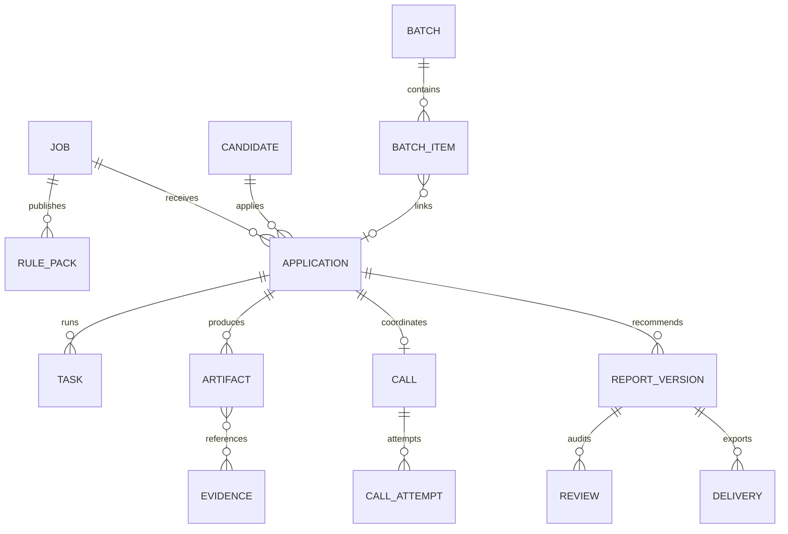

# HTTP 数据模型、状态与前端映射

本文解释 [OpenAPI 草案](openapi.v1.json) 的字段语义。HTTP 读模型与当前 `frontend/src/domain/workspace.ts` 的本地演示模型不同，接入时需要转换层。所有样例仅用于隔离测试。

## 1. 对象与版本关系

图中的一条 CALL 指首日初次联系的有效业务任务；历史已取消任务仍保留审计。它不是约束未来永远不能再有合法联系任务，是否允许新的业务目的须另行评审。任务、拨打尝试、报告版本与导出记录不能共用一个 ID 代替各自防重。

| 标识 | 含义 | 重要区分 |
| --- | --- | --- |
| `candidate_id` | 候选人档案身份 | 同名不自动合并，不等于简历文件 ID |
| `application_id` | 某候选人与某岗位的一次关联 | 当前候选人工作区路由应使用它；同人在不同岗位有不同关联 |
| `workflow_id` | 某次流程实例 | 显式重评估是否新建实例由编排器决定，不能变相增加外呼机会 |
| `file_id + version` | 原材料不可变版本 | 改名不产生新内容，去重由后端重新摘要 |
| `artifact_id + version` | D01—D10 的不可变快照 | 输入引用、规则与证据也带版本 |
| `report_id + version` | D10 稳定逻辑报告及具体版本 | 不是 D09 ID；每版关联一个 D10 ArtifactRef |
| `rule_pack_id + version` | 已发布规则包 | 全局唯一包 ID，版本在该岗位包内递增 |
| `revision` | 可变对象并发序号 | 不等于内容 version，审核状态改变也会增加 revision |

机构、负责人、创建人、审核人和时间由服务端从有效会话及记录填写，不能由浏览器任意指定。正文材料只是材料，不得改变系统权限与工具边界。

## 2. 公共模型

| 模型 | 核心字段 | 约束 |
| --- | --- | --- |
| `ArtifactRef` | `artifact_id`, `version` | 版本 ≥1，与已实现 A/B 引用形状相同 |
| `EvidenceRef` | `evidence_id`, `version` | 精确历史证据，不允许用 latest |
| `RulePackRef` | `rule_pack_id`, `version`, `publication_status`, `is_test_rule` | 仅引用已发布版本；与现有事件相同 |
| `Reason` | `code`, `message`, `missing_fields` | 未知／等待有具体原因，不仅是布尔值 |
| `Provenance` | `source_mode`, `inherited_source_modes`, `source_modes`, `fixture_only` | 来源由后端计算，下游保留上游 mock |
| `TaskAccepted` | `task_id`, `resource_type`, `resource_id`, `poll_after_ms` | 仅表示接受，不能展示“业务已完成” |
| `Error` | `code`, `message`, `request_id`, `details` | 仅稳定错误，不回显输入与第三方原始异常 |
| `*Page` | `items`, `total`, `page`, `page_size` | 按可见范围过滤后的计数；不能泄露其他机构 |

`SourceMode` 是 `live/mock/manual`。`source_modes` 的 `candidate_material/model/research/phone` 分别为 SourceMode 或 null。null 表示该阶段未执行或尚无可确认证据，不是 mock，也不等于 live。`source_mode` 表示当前内容生成方式；`inherited_source_modes` 表示其上游材料来源集合。展示是否为模拟应判断当前、继承、分阶段来源和 fixture_only，不能只看当前模型是否为 live。

HTTP 的 Provenance 是规划的读模型，不修改已有 `SourceModes` 事件 Pydantic；事件的四项来源非空且 `extra=forbid`。事件中 `artifact_refs` 恰好为 D01—D06，不允许照搬 HTTP 对象增加字段。

## 3. 会话、工作台与待办

`Session` 包含 `user{id,display_name}`、`organization{id,name}`、`permissions[]`、`csrf_token`、`expires_at`、`capabilities`。能力对象包含可用模块列表、是否允许隔离模拟、`import_limits{max_items,max_file_bytes,max_text_chars}`。这是已登录用户可见的能力声明，不返回第三方凭据、私有域名或账号配置。

`WorkspaceSummary` 包含 `as_of`、`source_scope=all/live/mock/manual` 和四个计数：`active_job_count`、`application_count`、`waiting_call_count`、`pending_report_count`。application_count 是岗位关联数量，不承诺去重候选人数。waiting_call_count 计 waiting_conditions/reconciling/stop_status=requested；未接但 awaiting_reschedule 不算正在通话。前端名称须随口径调整。

`Todo` 包含 ID、`type`、`title`、`reason`、`resource_type/resource_id`、可空 job_id/application_id、`created_at` 与来源。类型为 rule_confirmation/material_correction/identity_ambiguity/evidence_conflict/screening_review/report_review/external_reconciliation/delivered_report_correction。`resource_type/id` 用于受控内部路由，不返回可任意跳转的 URL 或可执行指令。

## 4. 岗位和规则

### 4.1 Job

| 字段 | 类型 | 说明 |
| --- | --- | --- |
| `id`, `organization_id`, `owner_id` | string | 会话与服务端归属 |
| `revision` | integer ≥1 | PATCH / analyze 的乐观锁 |
| `title`, `company` | string | 1—100 字符 |
| `location`, `salary` | string/null | 最长 100，未知保留 null，不解析为确定薪资事实 |
| `status` | `active/paused/archived` | 启停独立于规则发布；paused 禁新筛选与拨打 |
| `material_text`, `material_version` | string, integer | 创建时原文，后续业务事实不能靠改展示字段覆写 |
| `unknown_fields` | string[] | 来源材料未提及／冲突的字段路径 |
| `rule_status` | `draft/needs_information/pending_confirmation/published/disabled` | 规则生命周期 |
| `published_rule_pack_ref` | RulePackRef/null | 现行已发布快照，不能直接用 job.revision 代替 |
| `draft_revision` | integer ≥1 | 当前草案版本；即使有已发布版仍可编辑新草案 |
| `active_task_ids` | string[] | 刷新恢复分析状态 |
| `counts` | object | applications/pending_reports，按当前用户可见范围 |
| `provenance`, `created_at`, `updated_at` | 公共字段 | 时间带时区 |

### 4.2 RuleDraft / RulePack

RuleDraft 为 `{job_id,draft_revision,content,validation_issues,updated_at}`。`SaveRuleDraftInput` 中 `content` 整体替换草案，不合并缺失数组。服务端写入新 draft_revision；尚未发布的草案不影响历史任务。

RulePack 为 `{rule_pack_id,job_id,version,publication_status,is_test_rule,content,d01_ref,d02_ref,published_by,published_at}`。已发布内容不可 PATCH；`publication_status` 固定 published，运行可用性由岗位/规则停用及当前权限另行检查。历史“曾已发布”不代表当前允许继续执行。

`RuleContent` 定义：

| 字段 | 说明 |
| --- | --- |
| `screening_text` | 对应前端初筛标准文本，可空草案允许空串 |
| `interview_text` | D02 对应面试标准文本，不能直接照搬初筛门槛 |
| `recommendation_text` | 推荐口径说明 |
| `screening_conditions[]` | id、label、required_evidence、unknown_action=needs_information、mismatch_action=reject/manual_review；不把缺失归为明确不符 |
| `interview_dimensions[]` | id、label、rubric（评分锚点）、可空 weight、required_evidence、missing_action=not_evaluated |
| `recommendation_policy` | required_dimension_ids、decision_method、可空 threshold、manual_review_conditions；不同计分方式的发布校验一致 |
| `research_config_ref` | 配置 ID 与版本，固定字段、来源、时限、预算边界由对应配置校验 |
| `phone_config_ref` | 配置 ID 与版本，告知、时段、时长、预算、停止与重拨限制 |
| `method_config_ref` | 配置 ID 与版本，提问及 D09/D10 模板方法 |

研究／电话／方法引用可为 null 以保存不完整草案，正式发布前必须完整；不能猜测配置、评分阈值或授权。`decision_method` 为 rubric/weighted_score；weighted_score 必须有可解释阈值与有效权重，未覆盖维度不能通过重分配权重自动达标；rubric 不要求虚构分数，按版本化口径核验。具体专业标准与数值仍待业务方确认。

## 5. 批次、文件和关联

`Batch` 包含 id/job_id/task_id、status、规则引用、`counts{total,queued,processing,completed,failed,duplicate,cancelled}`、来源与时间。counts 的七个逐项桶除 total 外互斥，相加等于 total。`status=completed` 可包含 duplicate；有失败且仍在运行时仍 processing，有失败且无待执行时 partial_failed，全部失败为 failed。

`BatchItem` 包含 id/batch_id/client_item_id/revision、name、state、file_ref、candidate_id/application_id、task_id、duplicate_of_item_id、replaces_item_id、error、created_at。state 为 queued/processing/completed/duplicate/invalid/failed/cancelled。invalid 与 failed 都计入 batch.counts.failed，但 invalid 代表接收校验，failed 代表后续解析或计算失败。nullable 引用表示尚未建立，不能生成虚构候选人 ID。

`BatchAccepted` 为 `{batch_id,task_id,items:[{item_id,client_item_id,disposition,application_id,error}],poll_after_ms}`。disposition 为 accepted/duplicate/invalid。接收后的真实状态以 Batch 查询为准；接收成功不等于解析成功。

FileRef 为 `{file_id,version}`。二进制只通过权限端点读取，前端不直接使用对象存储临时 URL 来绕过权限、删除与生命周期限制。SHA-256 由后端重算；不向其他机构泄露命中情况或文件内容。

## 6. Application 和阶段槽位

Application（含列表摘要，详情补 `artifact_slots`）包含：

| 字段 | 说明 |
| --- | --- |
| `id`, `candidate_id`, `job_id`, `workflow_id`, `revision` | application 的 id 用于候选人工作区 |
| `candidate` | display_name/current_role/experience_text/education_text，未知字段为 null |
| `stage` | intake/research/screening/outreach/extraction/evaluation/recommendation/finished |
| `screening_result` | pending/passed/unknown/rejected/manual_review |
| `evaluation_result` | pending/insufficient/recommended/rejected/manual_review，尚未评估为 pending，不给默认推荐 |
| `summary`, `gaps[]`, `waiting_reason` | 有证据的摘要，缺口与技术原因分开 |
| `rule_pack_ref` | 实际使用的已发布测试／正式版本，不随岗位当前版静默变化 |
| `call_summary` | 可空 `{call_id,status,stop_status,reason,attempt_count,provenance}` |
| `report_summary` | 可空 `{report_id,version,revision,status,artifact_ref}`；D09 不达标时通常为空 |
| `active_task_ids`, `allowed_actions` | 刷新恢复与 UI 提示，后端仍重新鉴权 |
| `provenance`, `created_at`, `updated_at` | 来源与时间 |

`artifact_slots` 为 D03—D10 的阶段描述，每个含 type/state/reason/artifact_ref。不存在、未执行和失败不等于零内容完成；历史内容由产物版本端点查。TimelineEvent 为 id/type/title/detail/actor_type/actor_id/created_at/artifact_ref，可空 actor 允许系统事件，记录原始结论、人工覆盖、旧结果失效与导出，而非无版本的展示字符串。

## 7. Artifact 与 Evidence

Artifact 公共字段：artifact_id/type/version/status、job_id、可空 application_id、workflow_id、step、input_refs、rule_pack_ref、evidence_refs、provenance、generated_at、generator{kind,model,method_version}、unknowns、validation、可空 correction_of_ref、可空 superseded_by_ref。

`status` 为 valid/expired/restricted。valid 只说明当前产物未被失效，不说明来源已独立核实或报告已批准。限制访问时正文与原文都不能泄露；无权访问的用户返回 404，不返回 restricted 正文。列表只给 `ArtifactSummary`；精确读取再含 `content_markdown` 和 `structured_content`。Markdown 渲染禁原始 HTML 或执行性内容。

`InputRef` 为 `{kind,id,version}`，kind 为 material/artifact/rule_pack/evidence/config。引用集合保存生成时快照。`validation{passed,issues[]}` 不能代替真实业务专业质量验收。

各 D 类型结构至少保留以下字段；OpenAPI 用明确的 D01—D10 schema 分支，不以任意 JSON 作为业务校验的最终形态：

| 类型 | 结构字段与最低含义 |
| --- | --- |
| D01 | fields（名称/职责/地点/薪酬/目标等，值可空）、unknown_fields、conflicts |
| D02 | dimensions（维度/锚点/权重/证据要求）、recommendation_policy、confirmation_status |
| D03 | profile、employment、projects、skills、education、claims；自述含 evidence_refs |
| D04 | subjects、findings、conflicts、gaps、stop_reason、usage；没有联网调用不能说已研究完成 |
| D05 | experience_context、match_signals、gaps、verification_questions；推断须有来源 |
| D06 | conditions（condition_id、satisfied/not_satisfied/unknown、证据与理由）、conclusion、override_of_ref |
| D07 | questions（问题 ID/维度/必问/专属核实/追问条件）、termination_conditions |
| D08 | coverage=full/partial、qa（问答/追问/时间戳/证据）、conflicts、gaps、call_ref；完全无内容不造 D08 |
| D09 | dimensions（score 可空、not_evaluated 等状态、理由与证据）、coverage、conclusion、rule_pack_ref |
| D10 | candidate_summary、match_highlights、contribution_claims、job_intention、unknowns；不默认含内部完整评分 |

Evidence：evidence_id/version、subject_type/subject_id、category=E1/E2/E3/U、source_type、title、quote（可空）、original_material_ref（可空）、location{page,section,start_ms,end_ms}、public_url（可空）、source_date（可空）、retrieved_at、status、corrects_ref、provenance。

E1 是可核实公开事实，E2 是候选人自述，E3 是 AI 分析，U 是缺失／冲突。人工岗位需求／修订用 source_type=job_material/manual_revision 并允许 category=null，不强行归为 E1/E2。公开公司成果不能直接归为候选人的贡献。来源 URL 仅允许经过校验的公开 http/https，不回传私有端点、令牌链接或可执行协议。时间戳以毫秒表示，结束不得早于开始；不靠页码就宣称原文位置已核验。

## 8. Task、用量和恢复

Task 包含 id/kind/status/revision、resource_type/id、input_refs、result_refs、reason/error、attempt_count、retryable、allowed_actions、poll_after_ms、usage、budget、created_at/started_at/finished_at。`attempt_count` 是内部执行记录数，不等于电话拨打次数。

TaskStatus：queued/running/waiting_conditions/awaiting_external/reconciling/completed/failed/cancelled。retryable 仅对明确失败的内部任务开放。外部通信超时用 reconciling，不丢弃外部 request ID；不能把重试同 task 当成再次拨号。

Usage 中 tokens/search_count/call_seconds 可空，实际未结算不能伪造为 0。预算 `currency/limit/reserved/settled/estimated/remaining/reconciliation_status` 中金额为十进制字符串，区分预留、估算、实付与未知；并发任务由服务端事务预留，不能依靠前端余额校验。

## 9. Call、Attempt、授权

Call 包含 id/application_id/candidate_id/job_id/workflow_id/revision、status、stop_status、reason、rule_pack_ref、authorization_ref、scheduled_at、attempt_count、latest_attempt_id、prerequisites、allowed_actions、provenance 和时间。敏感联系方式不出现在普通任务列表；只能使用受保护 contact_point_id。

| 维度 | 枚举 | 说明 |
| --- | --- | --- |
| 业务 status | queued/waiting_conditions/scheduled/in_progress/awaiting_reschedule/reconciling/ended/cancelled | 与 StopStatus、每次尝试的结果独立 |
| stop_status | none/requested/confirmed/failed/unknown | requested/unknown 不显示已结束 |
| Attempt.status | registered/requesting/unknown/unanswered/declined/connected/in_progress/completed/interrupted/failed | 未接/拒绝/故障不等于能力不合格 |
| 联系前提 | contact_authorized/notice_ready/time_window/budget_available/no_active_contact/current_inputs_valid | 每项 pass/fail/unknown 及 reason；每次实际拨打前重新查询 |

CallAttempt 含 id/call_id/sequence、external_request_id、可空 external_session_id、status、stop_status、requested_at/connected_at/ended_at、result_reason、usage、billing_status。外部结果不明保持 unknown，不自动释放全部预算再次调用。服务商回调去重和业务防重是不同层次。

ContactAuthorization 为 authorization_id/version/application_id/contact_point_id、decision=granted/withdrawn、scope（telephone/recording/transcription）、evidence_refs、notice_version、valid_from/valid_until、recorded_by/recorded_at。`ContactAuthorizationInput` 指明期望旧版本（首次为 null）、证明来源与原因；服务端核验材料、主体、范围和有效期，不接受布尔值绕过前提。授权范围有差异时按实际模式限制录音／转写；有效联系授权并不自动授权交付给 HR。

## 10. 推荐、审核和交付

Report 包含 id/application_id/job_id、type 固定 D10、version/revision/status、artifact_ref、evaluation_ref（D09）、rule_pack_ref、content_markdown、unknowns、review（可空）、provenance、is_current、allowed_actions、created_at、updated_at。列表 `ReportSummary` 不含全文。审核人、批准时间、理由、具体版本和 revision 由后端写入。

Report.status 为 draft/pending_review/rejected/approved/expired。rejected 是报告退回，不是候选人能力 rejected。ReportReview 是 `{action,reason,reviewer_id,reviewed_at,version}`，不接受前端指定 reviewer。Report.version 内容不可变，审核只更新 revision/status；修订或模型重生成产生新的 version，旧批准不传递。只有当前有效且批准的 D10 可导出；D09 达标不足或发生上游失效时重新阻断。

Delivery 为 id/report_id/report_version/channel=markdown_download/status=export_response_issued/export_request_id/actor_id/created_at/provenance。该状态只证明服务端签发下载响应，不是用户保存成功或 HR 已收到。后续邮件／ATS 交付需另设请求、核对与防重合同，本轮不提供发送接口。

## 11. 关键状态迁移

| 对象 | 允许的主要迁移 | 不允许的捷径 |
| --- | --- | --- |
| 规则 | draft → needs_information/pending_confirmation → published；再次编辑新草案 → 新已发布版本 | 修改发布版原文、草案直接驱动筛选 |
| 初筛 | pending → passed/unknown/rejected/manual_review；人工复核生成新 D06 | 未知当负面、不保留原结论的覆盖 |
| 电话 | queued → waiting_conditions/scheduled → in_progress → ended；外部不明 → reconciling | pending/unknown 执行重拨、把 requested 当确认 |
| 停止 | none → requested → confirmed；超时 → unknown → 查询确认 | 浏览器点击后立即写 ended |
| 报告 | draft → pending_review → approved/rejected；修订后旧版 expired、新版 pending_review | approved 原地改文、继承旧批准、过期仍下载 |
| 更正 | 新事实版本 → 失效影响结果／阻断交付 → 显式内部重算 → 新审核 | 更正隐式重拨、重新生成隐式发送 |

上述不是放开任意两态迁移的通用 PATCH；服务端通过具体命令端点逐项检查。事务边界：发布＋快照；D06＋待交接事件；事件消费＋电话任务；回调状态＋后续任务；更正＋失效；新 D10＋旧版失效；审核 revision 竞争；导出批准检查＋快照＋审计。

## 12. 当前前端 → HTTP 映射

| 当前演示字段／逻辑 | HTTP 对应 | 接入注意 |
| --- | --- | --- |
| `SourceMode='real'` | `live` | 明确转换，不修改既有事件枚举 |
| `Candidate.id` | `Application.id` | candidate_id 另存；当前本地名字不能当正式身份键 |
| `Candidate.jobId` | `job_id` | 同机构对象权限仍由后端检查 |
| `Job.status='draft/published'` | `rule_status` | Job.status 改用 active/paused/archived，不能混用 |
| `Job.version` | `published_rule_pack_ref?.version` | 无发布版视图可显示 0，但不发送非法 version=0 |
| `rules.screening/interview/recommendation` | RuleContent 三个 `*_text` | 文本只是草案的一部分，缺结构化标准／配置时服务端拒绝发布 |
| `Candidate.ruleVersion` | `rule_pack_ref.version` | 永远使用实际绑定引用 |
| `Artifact.id/ruleVersion/evidenceIds` | artifact_id / rule_pack_ref / evidence_refs | 证据 ID 变为 ID＋版本，不丢快照 |
| `Artifact.content` | `content_markdown` | 安全渲染；structured_content 用于结构化核验 |
| `CallState.waiting/active/unknown/completed` | waiting_conditions/in_progress/reconciling/ended | UI 文案根据 provenance 显示真实或模拟 |
| `CallState.stopping` | stop_status=requested | 同时保留业务 status，不把两个维度合成一个后端字段 |
| `Report.state='pending'` | pending_review | rejected 为报告退回，不能改候选人筛选结论 |
| `ImportRecord.waiting/failed` | BatchItem.state＋error | 待上传／已接收／解析中／失败分别表达，不只留两种状态 |
| `Report.exports` | 指定 version 过滤后的 DeliveryPage.total 或服务端汇总 | 浏览器 click 计数不是服务端交付事实，不混计其他版本 |
| 本地 publish/review/revise/requestStop | 对应 POST/PATCH 命令后重新 GET | 不提前乐观显示成功，失败保留当前状态 |
| `reportMarkdown` 本地拼接 | 服务端 export 流 | 后端再次校验，不能相信浏览器传全文或 approved=true |

接入时后端返回新增字段前端应容忍，未知枚举以“待支持状态”显示并禁用危险操作；写请求应拒绝未声明字段，避免浏览器伪造 source_mode、审核人或机构。F 需新增实际 API DTO 与转换函数，不能直接覆盖本地演示对象再宣称完成联调。

## A 实现与设计稿的对齐记录（2026-11-14）

A 已将响应对齐到上述字段：BatchItem.state、互斥批次桶、CandidateProfile、Artifact structured_content/content_markdown、Reason 和 Provenance.source_modes。实际结构从 Python 导出到 `openapi.implemented.v1.json`。D01—D06 各自经过对应 Pydantic 内容模型校验；扩展 `facts` 保留字段值、精确原文、状态、证据引用和来源种类，供确定性初筛与受限更正使用。

初筛规则新增可空 predicate（发布时必填）。Task.kind 新增 batch 汇总类型；其资源为 batch，不允许将批次失败转换为通用重试。单份替换保留旧行；列表／计数默认按替换链末端统计，原始行仍通过 replaces_item_id 留痕。

1.1 交接事件区分计划电话模式与实际阶段来源；旧 1.0 保持不变。A 的 D04 无检索提供者时仍保存有效的“未执行说明”，status=valid 仅表示记录未失效，不能解释为研究已完成。材料中的公司信息与个人自述不等同公开核实事实。

D03 更正只接受 `/facts/{白名单字段}`，value 为带 status 与 quote 的结构，不能更正规则、系统权限或工具配置；新证据采用原证据 ID 的新版本并失效旧证据。D03—D10 受影响旧版本、待交接事件与内部任务同事务阻断，后续重算显式触发。B 后半段的任务停止、已交付记录定位与报告审批仍待 B 集成，不能由 A 的空列表推断已经验收。

`ScreeningCondition.required_evidence` 保持人工可读证据要求；新增 `evidence_sources` 单独声明程序核验来源（resume/manual_revision/public_web）。二者不可混用；发布时需与 predicate 一并完整确认。面试维度也必须有明确证据要求。Job 补充可空 d01_ref/d02_ref，供发布时读取精确版本。

Task.budget 增加可空 model_calls/model_tokens/search_calls，每项为 `{limit,reserved,used}` 的次数／Token 计数，金额字段保持 null。Session.capabilities 补充 model_configured/search_configured/voice_configured；配置标志不是供应商可用性验收。

D03Content 增加 research_objects。每项含 object_id、kind、name、period、parent_object_id、facts，事实值保留 quote/status/evidence_refs/source_type。name/period 也是事实对象，未知时不造确定值。D04Content 增加可空 report，结构见 [A03 report Schema](../contracts/a03-report.v1.schema.json)：系统 ID、精确版本、逐对象原始信息与身份、并列字段、来源引文、目标、缺口、事实核实问题、资源与停止原因。Pi 执行依赖受控工具合同，不新增浏览器工具执行接口。

D04 由可配置适配器执行固定计划，详见 [研究适配器](search-adapter.md)。配置与已发布规则允许时可保存 partial 结果；未执行时阶段来源为 null。扩展字段包括 declared_subjects（含逐主体 execution_state）、fields、sources（含 declared_subject、published_at、subject_identity、historical_applicability）、source_assertions 和 rejected_source_count。摘要 Evidence 带 public_url/source_date，全部为 U／待核实，不自动确认主体、任职历史或个人贡献；public_web 来源要求仍不满足。

共享产物写入器校验上游归属和有效性、自动继承来源，将输入引用保存为 `{kind,id,version}`。D01/D03 包含原始材料引用；姓名更正同步搜索标签但不改变身份 ID。原文件受限时，关联读取、列表／计数、批次展示和 worker 缓存均受限，重导入不能恢复旧受限材料。
